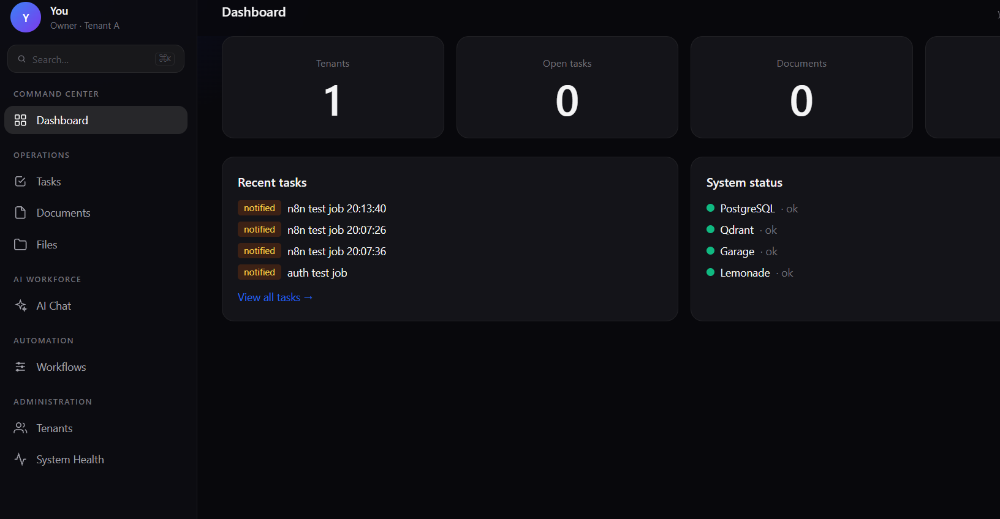
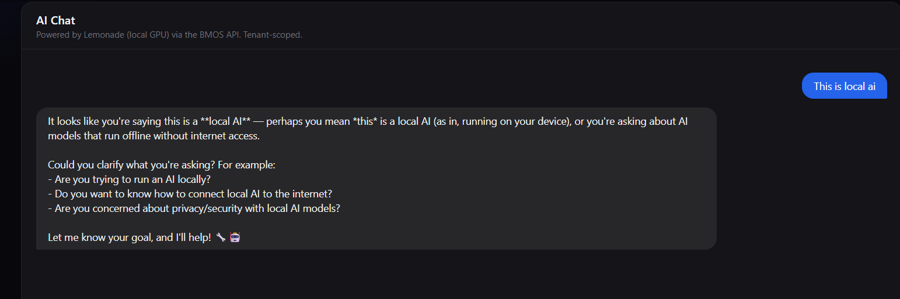
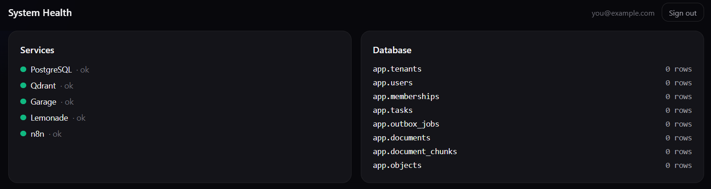

# NexGen CLD v4 (BMOS 3.2) — Multi-tenant Business OS

**PHP 8.4 + PostgreSQL 17 + Traefik + Nginx**, with Qdrant (vector search),
Garage (S3-compatible objects), Lemonade (local GPU AI), n8n (workflows),
Redis (optional queue), and a locked-down agent sandbox.

**Architecture:** PHP-native, server-rendered. PHP owns business logic,
auth, and persistence; PostgreSQL is authoritative for all business state
with **forced row-level security** (tenant isolation is database-enforced,
not code-filtered). Qdrant and Garage are rebuildable derived stores.
The web UI is Tailwind CSS + HTMX + Alpine.js in a dark "Figr Identity" aesthetic.





## Status

| Area | Status |
|------|--------|
| Core stack (Traefik → Nginx → PHP → Postgres) | ✅ Implemented, integration tested |
| Tenant isolation (forced RLS, 9/9 tests) | ✅ Security verified |
| Stage A authentication (sessions + API keys) | ✅ Implemented, integration tested |
| Outbox + worker (17/17) | ✅ Implemented, integration tested |
| Qdrant vector search (11/11) | ✅ Implemented, integration tested |
| Garage S3 objects (12/12) | ✅ Implemented, integration tested |
| Lemonade AI chat (6/6) | ✅ Implemented, integration tested |
| n8n workflows (4/4) | ✅ Implemented, integration tested |
| Agent sandbox (7/7) | ✅ Implemented, integration tested |
| Dark web UI (dashboard, tasks, AI chat, docs, files, workflows, tenants, health) | ✅ Implemented |
| Worker crash recovery | ⏳ Planned (Stage B) |
| TLS / HTTPS | ⏳ Planned (Stage C) |
| Projects, Evidence/Approvals, audit UI | ⏳ Planned (Stage D) |

**Authentication:** real sessions (bcrypt + httponly cookies) and per-tenant
Bearer API keys. Tenant identity comes from verified membership — the old
`X-Tenant-ID` demo header is gone.

## Stack

| Service | Image | Role |
|---------|-------|------|
| Traefik | `traefik:v3` | Edge router (:80) |
| Nginx | `nginx:1.28-alpine` | PHP-FPM reverse proxy |
| PHP | `php:8.4-fpm-alpine` | API + web UI (server-rendered) |
| Worker | (same PHP image) | Outbox job runner |
| Postgres | `postgres:17-alpine` | Authoritative store, forced RLS |
| Qdrant | `qdrant/qdrant:v1.13.0` | Vector index (rebuildable) |
| Garage | `dxflrs/garage:v2.4.1` | S3-compatible objects |
| n8n | `n8nio/n8n:1.113.0` | Workflows (profile-gated) |
| Redis | `redis:7-alpine` | n8n queue (profile-gated, optional) |

Lemonade Server runs on the **Windows host** (GPU), not in Docker.
PHP reaches it via `LEMONADE_URL`.

## Quickstart

```bash
# 1. Secrets (never commit these)
mkdir -p secrets && chmod 700 secrets
openssl rand -base64 24 | tr -d '\n' > secrets/postgres_password.txt
openssl rand -base64 24 | tr -d '\n' > secrets/app_password.txt
openssl rand -base64 24 | tr -d '\n' > secrets/migrator_password.txt
openssl rand -hex 32 | tr -d '\n' > secrets/garage_rpc_secret.txt
openssl rand -base64 24 | tr -d '\n' > secrets/garage_admin_token.txt
touch secrets/garage_app_key_id.txt secrets/garage_app_secret.txt
chmod 644 secrets/*.txt
cp .env.example .env

# 2. Start core stack
bash scripts/garage-config.sh
docker compose up -d
bash scripts/migrate.sh
bash scripts/garage-init.sh
docker compose restart php nginx

# 3. Create admin user
bash scripts/seed-admin.sh

# 4. Open http://bmos.localhost/login
```

Optional profiles:
```bash
bash scripts/n8n-init.sh
docker compose --profile n8n up -d                  # n8n (regular mode)
docker compose --profile n8n --profile queue up -d  # + Redis queue mode
docker compose --profile agents up -d               # agent sandbox
```

## Test suites

```bash
bash scripts/test-isolation.sh  # 9 passed — RLS tenant isolation
bash scripts/test-outbox.sh     # 17 passed — transactional outbox
bash scripts/test-qdrant.sh     # 11 passed — vector search, tenant-filtered
bash scripts/test-garage.sh     # 12 passed — S3 objects, presigned URLs
bash scripts/test-lemonade.sh   # 6 passed — local AI chat
bash scripts/test-n8n.sh        # 4 passed — workflow integration
bash scripts/test-auth.sh       # 6 passed — session auth, API keys
bash scripts/test-agents.sh     # 7 passed — sandbox isolation
bash scripts/test-redis.sh      # queue mode (optional)
```

## Web UI

Server-rendered PHP + Tailwind (CDN) + HTMX + Alpine.js, dark theme.
Sidebar: Command Center / Operations / AI Workforce / Automation / Administration.

- `/login` — sign in (bcrypt sessions)
- `/dashboard` — stats, recent tasks, system status
- `/tasks` — task management (HTMX)
- `/ai-ui` — AI chat (Lemonade, local GPU)
- `/documents` — document search
- `/objects-ui` — file upload/download (presigned URLs)
- `/workflows` — n8n integration dashboard
- `/tenants`, `/health-ui` — administration

## Auth model (Stage A)

- `POST /auth/login` → bcrypt verify → PHP session (httponly cookie)
- Tenant comes from **verified membership**, never a client header
- `Authorization: Bearer bmos_<key>` for server-to-server (n8n)
- `app.users` RLS uses SECURITY DEFINER functions owned by `bmos_migrator`
  (login must bypass RLS before identity is known)

## Notes

- **Two networks:** `edge` (Traefik, Nginx) and `backend` (internal).
- **Postgres is not published**; app connects via `postgres:5432`.
- **Secrets:** file-based Compose secrets under `secrets/` (chmod 644 so
  www-data can read; the 700 directory blocks other host users). Out of Git.
- **Roles:** `bmos_owner` (owns objects, no login), `bmos_migrator` (migrations),
  `bmos_app` (runtime, `NOBYPASSRLS`). RLS is **forced**.
- **Liveness vs readiness:** `/health` never touches the DB; `/ready` connects
  as `bmos_app`.
- **Worker:** handles SIGTERM gracefully. A crash mid-job leaves the row in
  `claimed` — no automatic reaper yet (Stage B). Handlers must be idempotent.

## Version matrix

| Component  | Image / version used | Notes |
|------------|----------------------|-------|
| Traefik    | `traefik:v3` | Observed 3.7.17, 2026-11-01 |
| Nginx      | `nginx:1.28-alpine` | |
| PHP        | `php:8.4-fpm-alpine` | `pdo_pgsql`, `pcntl` compiled in |
| PostgreSQL | `postgres:17-alpine` | |
| Qdrant     | `qdrant/qdrant:v1.13.0` | Derived vector index only |
| Garage     | `dxflrs/garage:v2.4.1` | S3-compatible, backend-only |

---

## Phase build notes (historical)

<details>
<summary>Phase 5 — Outbox pattern</summary>

`POST /jobs/enqueue` writes a business record (`app.tasks`) **and** the outbox
job (`app.outbox_jobs`) in **one** transaction. Duplicate `idempotency_key`
returns the original with `"deduplicated": true`.

The worker: peeks pending → sets tenant context → claims with
`FOR UPDATE SKIP LOCKED` → works → records done/backoff/dead.
</details>

<details>
<summary>Phase 6 — Qdrant as derived index</summary>

PostgreSQL is authoritative; Qdrant holds vectors only. Every point carries
`tenant_id`, so the collection can be wiped and rebuilt from PG at any time.
Embeddings are demo placeholders (`DemoEmbeddings`); swap in a real model
via `QDRANT_VECTOR_SIZE`.
</details>

<details>
<summary>Phase 7 — Garage S3 objects</summary>

PG holds metadata; Garage holds bytes. Clients use presigned URLs minted by
PHP after BMOS authorization. Garage S3 API is backend-only, no published ports.
</details>

<details>
<summary>Phase 8 — Lemonade (Windows host)</summary>

Stays on the Windows host (GPU), not a container. PHP reaches it via
`LEMONADE_URL`. No DB credentials to Lemonade; pure inference.
Qwen3.5 requests set `chat_template_kwargs.enable_thinking=false`.
</details>

<details>
<summary>Phase 9/10 — n8n (+ Redis queue)</summary>

Profile-gated. n8n calls BMOS APIs only — never bypasses auth, never gets
DB credentials. Regular mode first; Queue Mode is opt-in via `.env`.
</details>

<details>
<summary>Phase 11 — Agent sandbox (last)</summary>

No Docker socket, no DB credentials, no secrets. Backend network only —
calls BMOS APIs via `http://nginx` with auth enforced.
</details>
